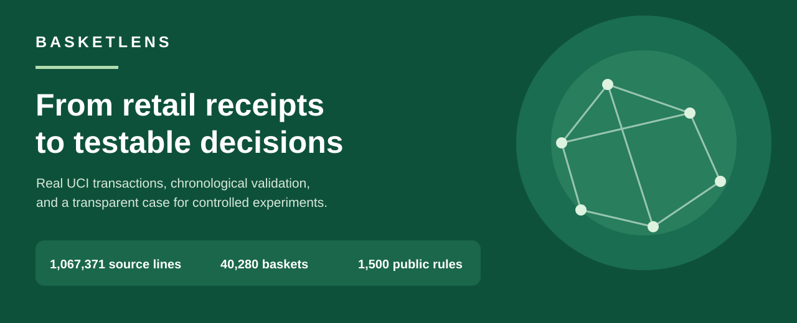

# BasketLens

**Retail market basket intelligence | Independent Data Analyst portfolio project**

[**View the Vercel portfolio site**](https://basketlens-fadhil-9768s-projects.vercel.app/) · [**Read the consulting case study**](docs/portfolio-case-study.md) · [**Review the methodology**](docs/methodology.md) · [**Publication kit**](docs/publication-readiness.md) · [**Inspect CI**](https://gitlab.com/fadhilrusydih/basketlens/-/pipelines)

BasketLens turns UCI Online Retail II receipts into auditable product-pair associations and tests whether those patterns appear again in later invoices. Its most important output is a **shortlist of testable retail hypotheses**, not a prediction of incremental revenue.

> **Evidence boundary:** support, confidence and lift describe historical co-occurrence. They do not establish the causal impact of bundling or product placement.

## At a glance

| Measure | Verified result |
| --- | ---: |
| Original source lines | **1,067,371** |
| Routine exclusions | **30,317** |
| Additional source lines quarantined | **5,773**, across 83 conflicting invoices |
| Eligible analysis lines | **1,031,281** |
| Valid invoice baskets | **40,280** |
| Earlier training baskets | **32,224** |
| Later holdout baskets | **8,056** |
| Full FP-Growth rule candidates | **113,001** |
| Curated training-selected rules in the public exhibit | **1,500** |

These counts come from the checksum-verified, aggregate-only public exhibit generated from the official UCI workbook. A separate sparse **pairwise** baseline is used for numerical cross-checks. Do not confuse its smaller rule count with the full FP-Growth total.

## One real business example

**Pink Polkadot Jumbo Bag (22386) → Red Retrospot Jumbo Bag (85099B)**

- Earlier baskets containing both products: **1,166**
- Training confidence: **63.1%**, lift: **6.24x**
- Later baskets containing Pink Polkadot: **416**
- Later baskets containing both: **279**
- Later confidence: **67.1%**, lift: **6.77x**

The example is selected with training-period evidence before the later outcomes are inspected. Its recurrence makes it worth **considering for a controlled placement or bundling test**, assuming inventory and contribution margins are acceptable. No uplift, profit, or modern retail relevance has been demonstrated.

The application also generates this decision brief dynamically from validated rule and holdout tables, so the display stays consistent with the selected research build.

## What the dashboard lets you do

The supported public experience is the [BasketLens Vercel dashboard](https://basketlens-fadhil-9768s-projects.vercel.app/). It uses audited aggregate-only data and does not mine the official workbook in visitors' browsers.

| Public Vercel screen | Available interaction |
| --- | --- |
| **Research overview** | Inspect historical basket KPIs, switch earlier training/later holdout evidence and review a controlled-test hypothesis. |
| **Rule Explorer** | Search 1,500 published associations by SKU/name, filter using training evidence and examine descriptive later-period counts. |
| **Example Basket Builder** | Select up to three published products and view matching historical candidates. It is not checkout or a causal recommender. |
| **Methodology** | Review exclusions, data provenance, limitations and source links. |

The Python/Streamlit application at `app/streamlit_app.py` remains a **local research workbench** with deeper analysis and exports, not an actively supported public Streamlit Cloud demo. Public pages do not expose raw invoices, customer IDs or transaction rows.

## Public deployment and release verification

**Vercel is the sole maintained public frontend.** It builds static `site/` assets from GitLab `main` (Root Directory `site`, output `dist`). [GitHub](https://github.com/Fadhilstat/BasketLens) is the reviewed portfolio mirror. Rule Explorer and Basket Builder share one browser-side audited dataset request.

Run `npm --prefix site test` and `npm --prefix site run build` locally. GitLab CI checks browser behavior and the anonymous production experience. The live [release manifest](https://basketlens-fadhil-9768s-projects.vercel.app/release.json) publishes the deployed Git SHA, public exhibit fingerprint and rule count. Compare its **full `gitSha` with current GitLab `main`** rather than relying on an old deployment identifier or READY badge. See [publication checklist](docs/publication-readiness.md) and [Vercel frontend contract](docs/vercel-frontend.md).

## Reproducible architecture

~~~text
Official UCI Online Retail II XLSX
   -> schema adapter and source lineage
   -> line-quality exclusions + invoice conflict audit
   -> 40,280 distinct eligible invoice baskets
   -> chronological train / holdout split
   -> sparse pairwise baseline + FP-Growth
   -> later confidence, lift and uncertainty diagnostics
   -> independently verified artifact bundle
   -> aggregate-only, SHA-256-checked public exhibit
   -> local Python/Streamlit analytical workbench
   -> aggregate-only static Vercel Explorer and Basket Builder
~~~

**Core stack:** Python, Pandas, NumPy, SciPy, mlxtend, Plotly, Streamlit, Pytest, Chromium/Playwright, GitLab CI and GitHub Actions.

## Run locally

Python 3.11 is recommended.

~~~bash
python -m venv .venv
source .venv/bin/activate
python -m pip install -e '.[dev]'
python -m basketlens.cli doctor
python -m basketlens.cli download
python scripts/source_conflict_audit.py --max-loss-fraction 0.01 --report reports
python -m basketlens.cli build --algorithm fpgrowth --inconsistent-policy quarantine
python -m basketlens.cli verify
streamlit run app/streamlit_app.py
~~~

On Windows, activate the virtual environment with .venv\Scripts\Activate.ps1. For local use without the full downloaded dataset, the published aggregate-only exhibit is automatically loaded when the processed directory is absent.

The code defaults to **fail closed** when source invoices have contradictory timestamps or countries. The quarantine mode above is explicit and should only be enabled after inspecting the conflict report.

### Tests

~~~bash
python -m compileall -q src app scripts
python -m pytest -q
python scripts/check_public_demo.py
python -m pip check
~~~

GitHub Actions tests Python research code and the public frontend. GitLab MRs retain mandatory unit, frontend/browser and Vercel guest smoke tests. The expensive UCI download, pairwise/FP-Growth full-source numerical audit, conflict check and Streamlit research QA run automatically only for data, analytics, research-test or CI changes. A docs/presentation-only MR retains a **manual, non-blocking** full audit. Confirm the actual jobs and SHA rather than inferring the audit ran from a green pipeline.

## Limitations and next step

- These are **2009–2011** historical transactions and may not generalise to today's products or customer mix.
- Positive merchandise values are not net revenue or profit after returns.
- The source does not include inventory, margin, promotion costs or experimental product exposure.
- Repeated customer behaviour can affect uncertainty estimates. Many association rules are screened without formal multiplicity adjustment.
- Temporal holdout can demonstrate descriptive repeat co-occurrence. **A randomized test** is needed to estimate incremental sales, conversion or margin.

**Proposed next experiment:** test adjacent display of the two bags for a defined eligible audience. Pre-register the primary outcome, power/sample size and guardrail metrics. Measure completed sales and contribution margin against a control after inventory checks.

## Project documentation

- [Consulting case study](docs/portfolio-case-study.md)
- [Research methodology](docs/methodology.md)
- [Validation protocol](docs/verification.md)
- [Product experience and accessibility](docs/experience.md)
- [Public exhibit format and privacy](data/public_demo/README.md)

## Source, license and author

Dataset: Chen, D. (2019), **Online Retail II**, UCI Machine Learning Repository, [DOI 10.24432/C5CG6D](https://doi.org/10.24432/C5CG6D), **CC BY 4.0**. The original dataset must be attributed, and raw data is not redistributed in this repo.

Application code: [MIT](LICENSE).

**Fadhil Rusydi Hafizh** · [GitHub](https://github.com/Fadhilstat) · [LinkedIn](https://www.linkedin.com/in/fadhilrusydi31/)

## Sharing this portfolio

Share the [guest-verified Vercel dashboard](https://basketlens-fadhil-9768s-projects.vercel.app/) and the source case study, not an unverified Streamlit Cloud URL. The M6.2 publication kit contains three consulting slides as separate 1920 x 1080 PNGs and an editable deck, not binaries committed to Git. See the [three-slide narrative](docs/social/three-slide-story.md), [LinkedIn copy](docs/social/linkedin-post.md) and [publication checklist](docs/publication-readiness.md).

Historical issue: the former Streamlit hosted URL failed anonymous QA on 2026-10-10 ([GitLab evidence](https://gitlab.com/fadhilrusydih/basketlens/-/jobs/17080255195)). The local Python/Streamlit source remains reproducible, but that failed public URL is not promoted. The later M7.3 Vercel main guest/provenance checks passed.

## M6.5 dashboard-style portfolio experience

The public Vercel front door has a dedicated **retail intelligence dashboard** layout rather than a generic case-study page: responsive research navigation, source-verified KPI tiles, training/holdout comparison, product-pair diagram, methods and a controlled-test decision brief. The Python/Streamlit analysis remains the reproducible research engine and is not replaced by a static frontend. The M6.5 redesign is historical; M7.3 subsequently passed production guest and exact-commit verification. Recheck each new release.

## M6.6: Rule Explorer on Vercel

The production-facing dashboard now exposes an interactive explorer for the **1,500 training-selected public rules**. Visitors can search stock codes or product names, filter the earlier-period training lift and co-purchase count, distinguish one- and two-product antecedents, and inspect later-period observational hits/fires. Results never rank or filter based on later-period performance. The interface includes genuine empty/error/retry states and progressive display for mobile readability.

The browser receives only whitelisted aggregate rule fields derived at build time from a SHA256-verified copy of `data/public_demo/basketlens_public_v1.b64`. No raw UCI invoices or personal identifiers are served. The canonical artifact remains under `data/public_demo/`, and site build CI rejects divergent hashes. Commands: `npm --prefix site test`, `npm --prefix site run build`, `python site/tests/explorer_browser_smoke.py`. Later releases, including M7.3, passed post-merge anonymous production QA for the Rule Explorer.

## M6.7: Basket Builder (example, not checkout)

The Vercel portfolio now lets a reviewer select up to three published antecedent products, load the verified Pink Polkadot example, inspect matching association rules, and clear individual products. Rules match only when all antecedent SKUs are present and the consequent is not already selected. Distinct candidate products are ordered by antecedent specificity and **earlier-training co-purchases, confidence and lift only**. Later hits/fires are clearly labelled as descriptive validation, not causal uplift, purchase probability, or actual customer recommendations. This deliberately works on the existing audited 1,500-rule static exhibit.

No new backend, database, client personal data, API token, analytics tracker, or VPS process was added. The Rule Explorer and Basket Builder share one browser-side data load. Acceptance: `npm --prefix site test`, `python site/tests/basket_browser_smoke.py`, existing frontend/real-UCI parity gates and signed-out Vercel production smoke after merge.

## M6.8 Vercel-only public release policy

BasketLens is published **only on Vercel**, with Rule Explorer and example Basket Builder. The historical Streamlit implementation is retained for research reproducibility but is no longer an active public deployment target. The optional external Streamlit Cloud guest CI job has been retired; mandatory Vercel guest, source parity, Python unit and browser regression checks remain. No analytical source, models or historical evidence were deleted.

Typography uses Manrope for controls, navigation, data and dense text, and Instrument Serif for editorial headings. Fonts load through a Google Fonts stylesheet with `display=swap`; system fallbacks preserve readability if it is blocked. The external font service is not a runtime backend.
